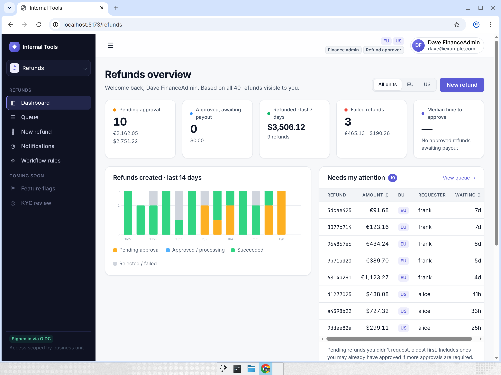

# Cognition Take-Home Demo

A shared foundation for internal tools, plus a production-grade **refunds dashboard** built on it.
It was built with Devin as a prototype for replacing Microsoft Power Apps at a fintech: Power Apps'
built-in governance, rebuilt as code the team owns, with transactional correctness for money.



## Quickstart
```bash
docker compose up -d --build                      # db, source-db, keycloak, api, worker, web, mailpit
docker compose exec api python -m app.demo_seed   # 40 refunds through the real API (safe to re-run)
```
| URL | What |
|---|---|
| http://localhost:5173 | Web app (sign in through Keycloak) |
| http://localhost:8025 | Mailpit: workflow emails |
| http://localhost:8000/docs | API |
| http://localhost:8080 | Keycloak (admin/admin, local only) |

**Demo users.** Every password is `demo-password`.

| User | Role | Business units |
|---|---|---|
| alice | refund agent | US |
| frank | refund agent | EU |
| bob | approver | US |
| carol | approver | US, EU |
| dave | finance admin + approver | US, EU |
| erin | viewer, with PII masked | US |

**Try:**
* A large refund needs 2 approvers, and finance gets an email.
* An amount ending in `.13` fails at the provider.
* Approving your own refund is blocked.
* frank can't see US refunds.
* Approve the same refund in two tabs: the second approval gets a version conflict.

## What it demonstrates
| Power Apps / Dataverse | Here |
|---|---|
| Entra ID sign-in | OIDC + PKCE (Keycloak locally; Entra/Okta/Google via `OIDC_*` env) |
| Security roles | Server-side RBAC on every route, plus a route × role × business-unit test matrix that fails CI on any unlisted route |
| Business units | Postgres row-level security; the app runs as a `NOBYPASSRLS` role with no DELETE |
| Field-level security | PII masking by role, plus column-level grants |
| Auditing | Append-only audit log, written in the same transaction as the change |
| Approvals (Power Automate) | Maker-checker enforced by a DB trigger; declarative rules in `config/workflows.yaml` |
| Connectors + DLP | Read-only connector to the client's system of record (`source-db`) |
| Governance | CI: tests on real Postgres, gitleaks, semgrep, pip-audit, npm audit, Dependabot |

**Money correctness:**
* Integer cents.
* Atomic refund reservation, with a DB check against over-refunding.
* Idempotency keys with request-hash checks.
* Versioned state transitions.
* Provider calls made outside DB transactions, using the refund ID as the idempotency key.
* Reconciliation of stuck payouts.
* A transactional outbox claimed with `FOR UPDATE SKIP LOCKED`.

Every claim has a concurrency or governance test that runs against real Postgres.

## Architecture
```
browser ──OIDC (PKCE)──▶ keycloak :8080
   │ bearer token
   ▼
 web :5173 (React/Vite) ──▶ api :8000 (FastAPI, role app_api, RLS) ──▶ db (refunds, approvals, audit, outbox)
                            worker (role app_worker: payouts, outbox, SLA) ──▶ db, mailpit (SMTP)
                            connector (read-only) ◀── source-db (client's system of record)
```

## Docs
* [System overview](docs/system-overview.md)
* [Key decisions](docs/key-decisions.md)
* [Build vs. buy](docs/build-vs-buy.md)
* [Security mapping](docs/security.md)
* [Threat model](docs/threat-model.md)
* [API contract](docs/api-contract.md)
* Conventions for humans and agents: [AGENTS.md](AGENTS.md)

## Develop and test
```bash
docker compose up -d db
cd backend && pip install -r requirements-dev.txt && ruff check . && ruff format --check . && pytest
cd frontend && npm ci && npm run lint && npm run typecheck && npm test && npm run build
```
